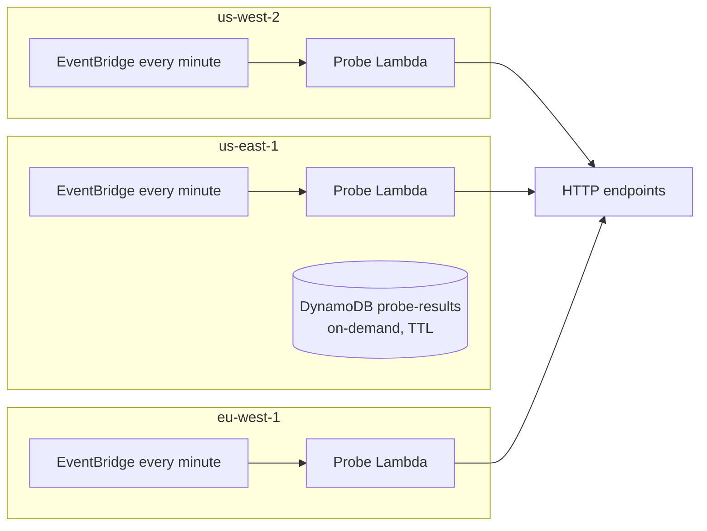

# status-probes

Multi-region HTTP probes on AWS, and the table a status page will eventually read. Each region checks the same endpoints once a minute and reports the status code and the latency. Nothing is deployed from this repository, and the probes do not write to DynamoDB yet.

## Architecture



`StatusData` creates `probe-results` in us-east-1 only. Billing is on-demand. The TTL attribute is `ttl` (epoch seconds). The partition key `pk` is the endpoint, and the sort key `sk` is reserved for the observation time and region. The table has deletion protection, termination protection, and point-in-time recovery, and it is retained on stack deletion.

`StatusProbe` is one stack per region: us-west-2, us-east-1, and eu-west-1. Each stack is a Python 3.12 Lambda (`probe.handler.handler`) and an EventBridge rule on a one-minute rate. The function's `ENDPOINTS` variable is a comma-separated list, taken from `PROBE_ENDPOINTS` at synth time or defaulting to `https://example.com`. The function returns its observations. It has no DynamoDB permissions and does not store them.

The three probe stacks do not reference the table, so they can be deployed in any order later.

## Local commands

Python 3.12. The CDK CLI is Node, pinned to the same version CI installs.

```bash
python3 -m venv .venv
source .venv/bin/activate
pip install -r requirements.txt -r requirements-dev.txt
npm install -g aws-cdk@2.1148.1

ruff check .
pytest
cdk synth
```

`cdk synth` does not need AWS credentials. When `CDK_DEFAULT_ACCOUNT` is unset, the app uses account `123456789012` so synthesis stays local. To bake a different endpoint list into the functions:

```bash
PROBE_ENDPOINTS="https://example.com,https://example.org" cdk synth
```

## Layout

| Path | What it is |
| --- | --- |
| `src/probe/checker.py` | GET one URL; status code and latency to headers |
| `src/probe/handler.py` | Lambda handler. Reads `ENDPOINTS`, returns the results |
| `tests/test_probe.py` | Pytest coverage of the checker and the handler, with HTTP mocked |
| `infra/status_data.py` | `StatusData` stack |
| `infra/status_probe.py` | `StatusProbe` stack |
| `app.py` | Wires the table and the three regional probes |
| `.github/workflows/ci.yml` | ruff, pytest, and `cdk synth` |

## Roadmap

Not built. Listed so the next change has a place to start.

- [ ] **Quorum aggregation across regions.** Treat an endpoint as up or down only when a majority of us-west-2, us-east-1, and eu-west-1 agree, so one region's network blip does not flip the status.
- [ ] **DynamoDB global table replicas.** Add replicas of `probe-results` in us-west-2 and eu-west-1, and let each probe write in its own region.
- [ ] **Static status page (S3 + CloudFront).** Publish the aggregated status as a static site.
- [ ] **SNS alerts on status change.** Notify when an endpoint moves between up and down, not on every minute's probe.
- [ ] **OIDC deploy workflow.** Let GitHub Actions assume an IAM role and run `cdk deploy`, with no long-lived AWS keys.
- [ ] **Cost estimate.** Price the three minute-schedule Lambdas, the on-demand table, and the later CloudFront distribution before anything is turned on.
