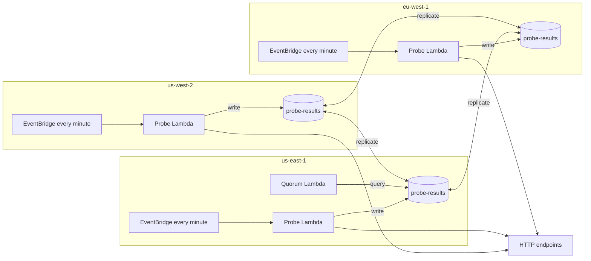

# status-probes

Multi-region HTTP probes on AWS, and the table a status page will eventually read. Each region checks the same endpoints once a minute, reports the status code and the latency, and writes that observation to the DynamoDB replica in its own region. A reader in us-east-1 queries those observations and reports up or down only when a majority of the three regions agree. Nothing is deployed from this repository.

## Architecture



`StatusData` creates `probe-results` as one global table. The stack is in us-east-1, and the table has a replica in us-east-1, us-west-2, and eu-west-1. Billing is on-demand. The TTL attribute is `ttl` (epoch seconds). TTL is one setting for the whole table, and a TTL delete in one replica is replicated to the others. The partition key `pk` is the endpoint URL. The sort key `sk` is the ISO-8601 UTC observation time, a `#`, and the probe region, for example `2026-11-15T13:20:01.250000Z#eu-west-1`. Each replica has deletion protection and point-in-time recovery. DynamoDB does not copy those two settings from one replica to another, so the template sets them on every replica. The stack has termination protection, and the table is retained on stack deletion.

The consistency mode is multi-Region eventual consistency. DynamoDB uses that mode when none is chosen, and this template sets it explicitly. A write in one replica is copied to the others asynchronously. [How DynamoDB global tables work](https://docs.aws.amazon.com/amazondynamodb/latest/developerguide/V2globaltables_HowItWorks.html) says those copies typically arrive within a second or less, and that the mode cannot be changed after the table is created. This table keeps eventual consistency. The strong-consistency mode does not support a TTL attribute. Replication reads each replica's DynamoDB stream, so the template enables `NEW_AND_OLD_IMAGES`. That stream cannot be turned off on these replicas. The us-east-1 reader can miss a write from another region until the copy arrives. A region with no fresh observation does not flip the status.

The construct is `TableV2`, which synthesizes `AWS::DynamoDB::GlobalTable`. The previous construct synthesized `AWS::DynamoDB::Table`. CloudFormation replaces a resource when its type changes, and a replacement would drop the items in a table that had already been deployed. Nothing in this repository is deployed, so there is no table to migrate.

`StatusProbe` is one stack per region: us-west-2, us-east-1, and eu-west-1. Each stack is a Python 3.12 Lambda (`probe.handler.handler`) and an EventBridge rule on a one-minute rate. The function package is `src/`. Lambda's Python 3.12 runtime provides boto3, so the package does not vendor it. The function's `ENDPOINTS` variable is a comma-separated list, taken from `PROBE_ENDPOINTS` at synth time or defaulting to `https://example.com`. `TABLE_NAME` is `probe-results` and `TABLE_REGION` is the stack's own region, so each probe writes to the replica beside it. The probe region on each item is `AWS_REGION`, which Lambda sets. An item also stores the status code, the latency in milliseconds, `ok`, `error`, and `ttl`. `ttl` is the time of the observation plus `RESULT_RETENTION_DAYS` (default 7). One observation is a PutItem. More than one uses the batch writer. The function returns its observations. If the write fails, it logs those observations and re-raises: the results stay in the log, and the invocation fails.

The role may call `dynamodb:PutItem` and `dynamodb:BatchWriteItem` on `arn:aws:dynamodb:<region>:<account>:table/probe-results`, where `<region>` is the stack's region. Those are its only added actions. The ARN is built from the table name, the stack account, and that region. The probe stacks do not import the table, so they can be deployed in any order later.

`StatusQuorum` is one function in us-east-1, `probe.reader.handler`, named `status-quorum`. It is not on a schedule. An invoker passes `endpoint`. The function queries the us-east-1 replica for the last three minutes and returns the endpoint, the status, and the regions that voted up, voted down, or had no fresh observation. For each of us-west-2, us-east-1, and eu-west-1 it keeps the latest observation in the window. The endpoint is up when at least two of those regions are fresh and `ok`, and down when at least two are fresh and not `ok`. One region, a split, or a stale sample is unknown, so one region's blip does not flip the status. The role may call `dynamodb:Query` on `arn:aws:dynamodb:us-east-1:<account>:table/probe-results`. That is its only added action. This stack does not import the table either.

## Local commands

Python 3.12. The CDK CLI is Node, pinned to the same version CI installs.

```bash
python3 -m venv .venv
source .venv/bin/activate
pip install -r requirements.txt -r requirements-dev.txt
npm install -g aws-cdk@2.1148.1

ruff check .
pytest
cdk synth
```

`cdk synth` does not need AWS credentials. When `CDK_DEFAULT_ACCOUNT` is unset, the app uses account `123456789012` so synthesis stays local. To bake a different endpoint list into the functions:

```bash
PROBE_ENDPOINTS="https://example.com,https://example.org" cdk synth
```

## Layout

| Path | What it is |
| --- | --- |
| `src/probe/checker.py` | GET one URL; status code and latency to headers |
| `src/probe/writer.py` | One observation as a `probe-results` item, then PutItem or the batch writer |
| `src/probe/handler.py` | Lambda handler. Reads `ENDPOINTS`, stores observations, returns them |
| `src/probe/quorum.py` | Latest fresh observation per region, then up, down, or unknown |
| `src/probe/reader.py` | Query one endpoint's window and return the quorum. Lambda handler |
| `tests/test_probe.py` | Pytest coverage of the checker and the handler, with HTTP mocked |
| `tests/test_writer.py` | Item shape (`pk`, `sk`, `ttl`) and handler writes. DynamoDB is mocked |
| `tests/test_quorum.py` | Quorum votes. No AWS |
| `tests/test_reader.py` | Window query and handler. DynamoDB is mocked |
| `tests/test_status_data.py` | Synthesized template: replicas, TTL, PITR, and retention |
| `tests/test_status_probe.py` | Synthesized template: per-region env vars and the write policy |
| `tests/test_status_quorum.py` | Synthesized template: the query policy, and no schedule |
| `infra/status_data.py` | `StatusData` stack |
| `infra/status_probe.py` | `StatusProbe` stack |
| `infra/status_quorum.py` | `StatusQuorum` stack |
| `app.py` | Wires the table, the three regional probes, and the quorum reader |
| `.github/workflows/ci.yml` | ruff, pytest, and `cdk synth` |

## Roadmap

Listed so the next change has a place to start. Nothing in this repository is deployed.

- [x] **Quorum aggregation across regions.** Treat an endpoint as up or down only when a majority of us-west-2, us-east-1, and eu-west-1 agree, so one region's network blip does not flip the status. The reader and the us-east-1 function are in the repo. They are not deployed, and nothing publishes the result yet.
- [x] **DynamoDB global table replicas.** Add replicas of `probe-results` in us-west-2 and eu-west-1, and let each probe write in its own region. The global table and the regional write roles are in the repo. Nothing is deployed.
- [ ] **Static status page (S3 + CloudFront).** Publish the aggregated status as a static site.
- [ ] **SNS alerts on status change.** Notify when an endpoint moves between up and down, not on every minute's probe.
- [ ] **OIDC deploy workflow.** Let GitHub Actions assume an IAM role and run `cdk deploy`, with no long-lived AWS keys.
- [ ] **Cost estimate.** Price the three minute-schedule Lambdas, the on-demand table, and the later CloudFront distribution before anything is turned on.
