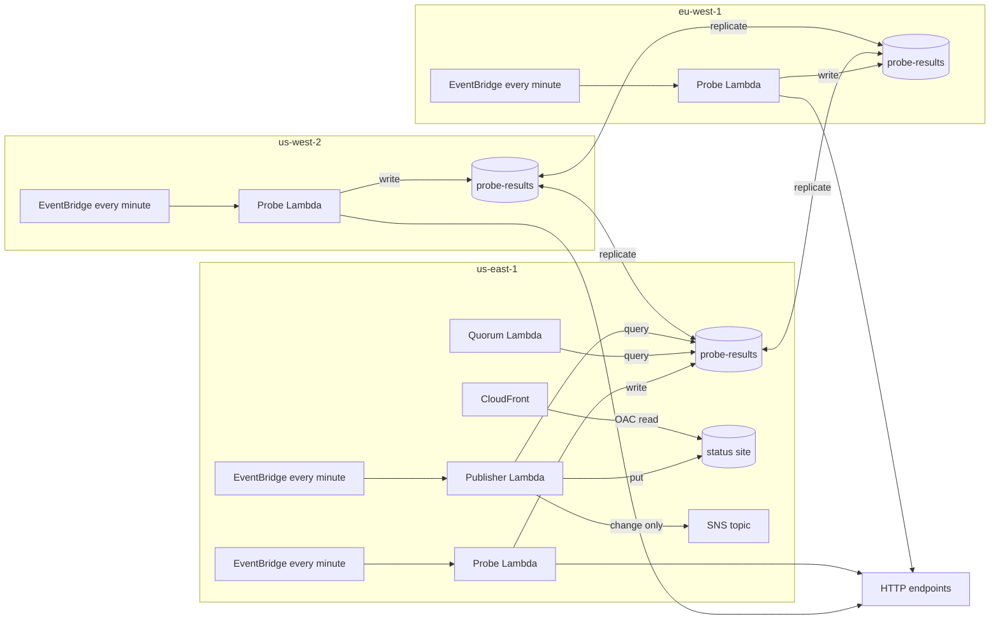

# status-probes

Multi-region HTTP probes on AWS. Each region checks the same endpoints once a minute, reports the status code and the latency, and writes that observation to the DynamoDB replica in its own region. A reader in us-east-1 reports up or down only when a majority of the three regions agree. A publisher in the same region writes that result to a private S3 bucket once a minute, and CloudFront serves the bucket. When an endpoint's aggregated status moves between up and down, that publisher sends one message to an SNS topic. Nothing is deployed from this repository.

## Architecture



`StatusData` creates `probe-results` as one global table. The stack is in us-east-1, and the table has a replica in us-east-1, us-west-2, and eu-west-1. Billing is on-demand. The TTL attribute is `ttl` (epoch seconds). TTL is one setting for the whole table, and a TTL delete in one replica is replicated to the others. The partition key `pk` is the endpoint URL. The sort key `sk` is the ISO-8601 UTC observation time, a `#`, and the probe region, for example `2026-11-15T13:20:01.250000Z#eu-west-1`. Each replica has deletion protection and point-in-time recovery. DynamoDB does not copy those two settings from one replica to another, so the template sets them on every replica. The stack has termination protection, and the table is retained on stack deletion.

The consistency mode is multi-Region eventual consistency. DynamoDB uses that mode when none is chosen, and this template sets it explicitly. A write in one replica is copied to the others asynchronously. [How DynamoDB global tables work](https://docs.aws.amazon.com/amazondynamodb/latest/developerguide/V2globaltables_HowItWorks.html) says those copies typically arrive within a second or less, and that the mode cannot be changed after the table is created. This table keeps eventual consistency. The strong-consistency mode does not support a TTL attribute. Replication reads each replica's DynamoDB stream, so the template enables `NEW_AND_OLD_IMAGES`. That stream cannot be turned off on these replicas. The us-east-1 reader can miss a write from another region until the copy arrives. A region with no fresh observation does not flip the status.

The construct is `TableV2`, which synthesizes `AWS::DynamoDB::GlobalTable`. The previous construct synthesized `AWS::DynamoDB::Table`. CloudFormation replaces a resource when its type changes, and a replacement would drop the items in a table that had already been deployed. Nothing in this repository is deployed, so there is no table to migrate.

`StatusProbe` is one stack per region: us-west-2, us-east-1, and eu-west-1. Each stack is a Python 3.12 Lambda (`probe.handler.handler`) and an EventBridge rule on a one-minute rate. The function package is `src/`. Lambda's Python 3.12 runtime provides boto3, so the package does not vendor it. The function's `ENDPOINTS` variable is a comma-separated list, taken from `PROBE_ENDPOINTS` at synth time or defaulting to `https://example.com`. `TABLE_NAME` is `probe-results` and `TABLE_REGION` is the stack's own region, so each probe writes to the replica beside it. The probe region on each item is `AWS_REGION`, which Lambda sets. An item also stores the status code, the latency in milliseconds, `ok`, `error`, and `ttl`. `ttl` is the time of the observation plus `RESULT_RETENTION_DAYS` (default 7). One observation is a PutItem. More than one uses the batch writer. The function returns its observations. If the write fails, it logs those observations and re-raises: the results stay in the log, and the invocation fails.

The role may call `dynamodb:PutItem` and `dynamodb:BatchWriteItem` on `arn:aws:dynamodb:<region>:<account>:table/probe-results`, where `<region>` is the stack's region. Those are its only added actions. The ARN is built from the table name, the stack account, and that region. The probe stacks do not import the table, so they can be deployed in any order later.

`StatusQuorum` is one function in us-east-1, `probe.reader.handler`, named `status-quorum`. It is not on a schedule. An invoker passes `endpoint`. The function queries the us-east-1 replica for the last three minutes and returns the endpoint, the status, and the regions that voted up, voted down, or had no fresh observation. For each of us-west-2, us-east-1, and eu-west-1 it keeps the latest observation in the window. The endpoint is up when at least two of those regions are fresh and `ok`, and down when at least two are fresh and not `ok`. One region, a split, or a stale sample is unknown, so one region's blip does not flip the status. The role may call `dynamodb:Query` on `arn:aws:dynamodb:us-east-1:<account>:table/probe-results`. That is its only added action. This stack does not import the table either.

`StatusPage` is one stack in us-east-1. It is a Python 3.12 Lambda (`probe.publisher.handler`, named `status-publisher`) and an EventBridge rule on a one-minute rate. `ENDPOINTS` is the same comma-separated list the probes use, taken from `PROBE_ENDPOINTS` at synth time. The function does not invoke `status-quorum`. It queries the us-east-1 replica for each endpoint, using the same window and majority as the reader. It writes `index.html`, then `status.json`. `status.json` is the generated time and, for each endpoint, the status and the regions that voted up, voted down, or had no fresh observation. `index.html` fetches `status.json` and does not embed the status. A failed query leaves the previous objects in place. A failed JSON write leaves the previous status behind the page, which reads that file. Both objects are UTF-8, use `Cache-Control: public, max-age=60`, and are encrypted with SSE-S3.

The bucket blocks all public access, enforces bucket-owner object ownership so ACLs are off, encrypts with an S3-managed key, and denies any request that is not SSL. It is not a website endpoint. CloudFront reads the bucket's regional domain with origin access control and signs every origin request with SigV4. The bucket policy allows that distribution `s3:GetObject` on the bucket's objects. Viewers are redirected from HTTP to HTTPS. The default root object is `index.html`. The cache keeps an object for at most 60 seconds and does not vary on cookies, headers, or query strings. The price class is `PriceClass_100`. The role may call `s3:PutObject` on the `status.json` and `index.html` keys only, and `dynamodb:Query` on `arn:aws:dynamodb:us-east-1:<account>:table/probe-results`. It may also call `dynamodb:GetItem`, `dynamodb:PutItem`, and `dynamodb:UpdateItem` on that same table ARN, and `sns:Publish` on the `status-changes` topic only. Those are its only added actions. The role has no KMS grant. The stack does not import the table. The bucket's deletion policy is `Delete`. CloudFormation will not delete a bucket that still has objects.

After the page is written, the function compares each endpoint's quorum with the last up or down it stored. That record is an item in the us-east-1 replica. The partition key is the endpoint, and the sort key is `#status`, which sorts before every observation key, so the freshness query does not return it. The item has no `ttl` attribute, so the table does not expire it. The first time an endpoint is up or down, the function stores that status and does not publish. The same status on a later minute does not publish. Unknown does not publish and does not replace a stored up or down, so a minute without a majority is not treated as a status change. A move from up to down, or from down to up, is a conditional update: it is stored only when the item still has the previous status. Only the invocation that stores the change publishes. The message names the endpoint, the previous status, the new status, and the time. A retry that already stored the new status, or that loses the condition, does not publish a second message. If the publish fails, the function writes the previous status back under the same kind of condition and raises, so the next invocation can send it. The topic's name is `status-changes`. It has no subscription. A failed notification leaves the page that was just written in the bucket. Nothing in this stack is deployed.

`GithubDeploy` is one stack in us-east-1. It is the IAM OIDC provider for `https://token.actions.githubusercontent.com` and a role named `github-status-probes-deploy`. The provider's client id is `sts.amazonaws.com`. The role trusts that provider for `sts:AssumeRoleWithWebIdentity` only when `aud` is `sts.amazonaws.com`, `sub` is `repo:nickmori05@314151628/status-probes@1458305886:environment:production`, `ref` is `refs/heads/main`, `environment` is `production`, `repository_id` is `1458305886`, and `repository_owner_id` is `314151628`. This repository was created on 2026-11-15. GitHub puts the owner id and the repository id in the subject of a repository created after 2026-07-15. The older subject, `repo:nickmori05/status-probes:environment:production`, is not what this repository sends. The comparisons are `StringEquals`. The subject has no wildcard. A `*` written under `StringEquals` is a literal character and matches no token. `StringLike` would treat `*` as a wildcard, and a pattern such as `repo:nickmori05/status-probes:*` would also match a pull request, and it would not match this subject. A job that names the `production` environment does not put `ref:refs/heads/main` in `sub`. The branch is the separate `ref` claim. `ForAllValues` is not used, because that operator matches when the key is missing. The role may call `sts:AssumeRole` and `sts:TagSession` on the CDK deploy, file-publishing, and lookup roles in us-east-1, us-west-2, and eu-west-1. The qualifier in those names is the CDK default, `hnb659fds`. The role may not assume the CloudFormation execution role or the image-publishing role. The provider does not pin a certificate thumbprint. IAM reads the current intermediate certificate, and it checks this issuer with its trusted roots. Nothing in this stack is deployed.

## Local commands

Python 3.12. The CDK CLI is Node, pinned to the same version CI installs.

```bash
python3 -m venv .venv
source .venv/bin/activate
pip install -r requirements.txt -r requirements-dev.txt
npm install -g aws-cdk@2.1148.1

ruff check .
pytest
cdk synth
python -m cost.estimate
```

`cdk synth` and the cost estimate do not need AWS credentials. When `CDK_DEFAULT_ACCOUNT` is unset, the app uses account `123456789012` so synthesis stays local. To bake a different endpoint list into the functions:

```bash
PROBE_ENDPOINTS="https://example.com,https://example.org" cdk synth
```

## Deploying

`.github/workflows/deploy.yml` runs only when someone starts it (`workflow_dispatch`). A push or a pull request does not start it. The job requests an OIDC token (`id-token: write`) and reads the repository (`contents: read`). It uses the GitHub environment `production`. `aws-actions/configure-aws-credentials` assumes the role named by the environment variable `AWS_DEPLOY_ROLE_ARN`, with audience `sts.amazonaws.com`. That value is a variable, not a secret. The workflow has no AWS access key. The job then runs `cdk deploy` for `GithubDeploy`, `StatusData`, the three `StatusProbe` stacks, `StatusQuorum`, and `StatusPage`.

The workflow cannot create the role it assumes, and it cannot bootstrap an account. Both are one-time steps. This repository has not run them.

An administrator deploys `GithubDeploy` once, with credentials that are not this role. That creates the provider and `github-status-probes-deploy`. An account can hold only one IAM OIDC provider for `https://token.actions.githubusercontent.com`. If that URL is already registered, creating this stack fails.

Bootstrap then runs in the three regions. `--trust` adds the role to the deploy, file-publishing, lookup, and image-publishing roles, for `sts:AssumeRole` and `sts:TagSession`. The role's own policy does not allow the image-publishing role. The functions are zip files. `--trust` has to be passed with `--cloudformation-execution-policies`. `AdministratorAccess` is what a same-account bootstrap attaches when no trust is set. With `--trust`, that policy is named explicitly, and it is attached to `cdk-hnb659fds-cfn-exec-role-*`, which CloudFormation assumes. The GitHub role cannot assume that role.

```bash
cdk bootstrap aws://ACCOUNT/us-east-1 aws://ACCOUNT/us-west-2 aws://ACCOUNT/eu-west-1 \
  --trust arn:aws:iam::ACCOUNT:role/github-status-probes-deploy \
  --cloudformation-execution-policies arn:aws:iam::aws:policy/AdministratorAccess
```

The GitHub environment `production` is created before anyone runs the workflow, and it is limited to the `main` branch. Its variable `AWS_DEPLOY_ROLE_ARN` is `arn:aws:iam::ACCOUNT:role/github-status-probes-deploy`. The trust policy already requires `refs/heads/main`. The environment rule is the same limit on the GitHub side.

Nothing in this repository is deployed. Running the workflow later would deploy the stacks. Opening a pull request does not run it.

## Layout

| Path | What it is |
| --- | --- |
| `src/probe/checker.py` | GET one URL; status code and latency to headers |
| `src/probe/writer.py` | One observation as a `probe-results` item, then PutItem or the batch writer |
| `src/probe/handler.py` | Lambda handler. Reads `ENDPOINTS`, stores observations, returns them |
| `src/probe/quorum.py` | Latest fresh observation per region, then up, down, or unknown |
| `src/probe/reader.py` | Query one endpoint's window and return the quorum. Lambda handler |
| `src/probe/publisher.py` | Quorum for each `ENDPOINTS` URL, then `status.json`, `index.html`, and a change notification |
| `src/probe/alerts.py` | Last up or down for an endpoint, then SNS only when it changes |
| `tests/test_probe.py` | Pytest coverage of the checker and the handler, with HTTP mocked |
| `tests/test_writer.py` | Item shape (`pk`, `sk`, `ttl`) and handler writes. DynamoDB is mocked |
| `tests/test_quorum.py` | Quorum votes. No AWS |
| `tests/test_reader.py` | Window query and handler. DynamoDB is mocked |
| `tests/test_publisher.py` | Rendering, publishing, and one notification. DynamoDB and S3 are mocked |
| `tests/test_alerts.py` | Transition, no change, first observation, and a retry. DynamoDB is moto; SNS is a fake |
| `tests/test_status_data.py` | Synthesized template: replicas, TTL, PITR, and retention |
| `tests/test_status_probe.py` | Synthesized template: per-region env vars and the write policy |
| `tests/test_status_quorum.py` | Synthesized template: the query policy, and no schedule |
| `tests/test_status_page.py` | Synthesized template: OAC, private bucket, topic, publish permission, schedule |
| `tests/test_github_deploy.py` | Synthesized template: trust conditions and the bootstrap assume |
| `tests/test_cost_estimate.py` | Monthly estimate: the arithmetic, the allowances, and the quoted total |
| `cost/estimate.py` | Computes that estimate from the assumptions and the unit prices |
| `docs/COST.md` | The assumptions, the prices, and the monthly total. Nothing is deployed |
| `infra/status_data.py` | `StatusData` stack |
| `infra/status_probe.py` | `StatusProbe` stack |
| `infra/status_quorum.py` | `StatusQuorum` stack |
| `infra/status_page.py` | `StatusPage` stack. Publisher, private bucket, CloudFront, and the status-changes topic |
| `infra/github_deploy.py` | `GithubDeploy` stack. OIDC provider and the deploy role |
| `app.py` | Wires the table, the three regional probes, the quorum reader, the status page, and the deploy role |
| `.github/workflows/ci.yml` | ruff, pytest, and `cdk synth` |
| `.github/workflows/deploy.yml` | Manual `cdk deploy`. OIDC, no AWS keys. A pull request does not run it |

## Roadmap

Listed so the next change has a place to start. Nothing in this repository is deployed.

- [x] **Quorum aggregation across regions.** Treat an endpoint as up or down only when a majority of us-west-2, us-east-1, and eu-west-1 agree, so one region's network blip does not flip the status. The reader and the us-east-1 function are in the repo. They are not deployed. The status page publishes the result.
- [x] **DynamoDB global table replicas.** Add replicas of `probe-results` in us-west-2 and eu-west-1, and let each probe write in its own region. The global table and the regional write roles are in the repo. Nothing is deployed.
- [x] **Static status page (S3 + CloudFront).** Publish the aggregated status as a static site. The publisher, the private bucket, and the CloudFront distribution are in the repo. Nothing is deployed.
- [x] **SNS alerts on status change.** Notify when an endpoint moves between up and down, not on every minute's probe. The topic and the transition check are in the repo. The topic has no subscription. Nothing is deployed.
- [x] **OIDC deploy workflow.** Let GitHub Actions assume an IAM role and run `cdk deploy`, with no long-lived AWS keys. The provider, the role, and the manual workflow are in the repo. Nothing is deployed.
- [x] **Cost estimate.** Price the three minute-schedule Lambdas, the on-demand table, and the later CloudFront distribution before anything is turned on. The monthly numbers are in `docs/COST.md`. Nothing is deployed.
